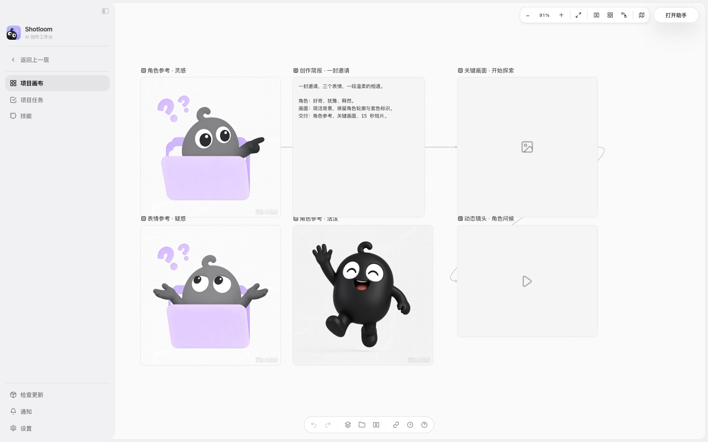
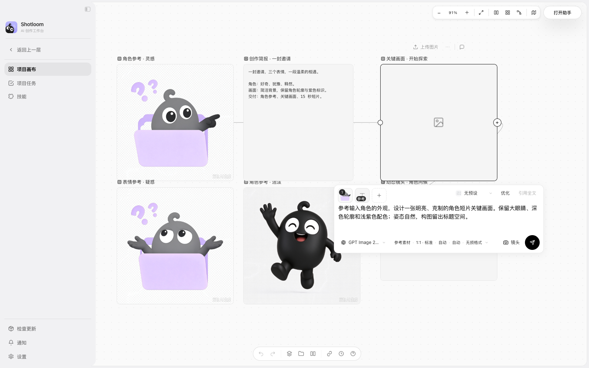
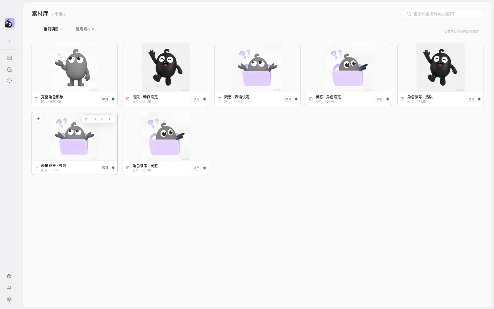
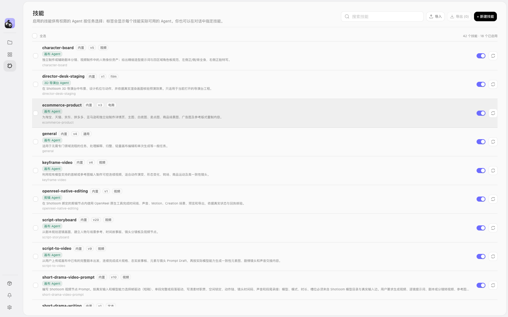
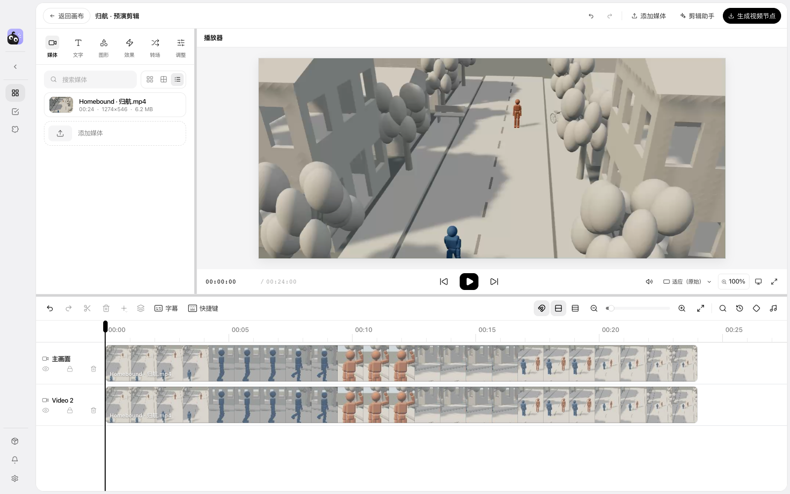
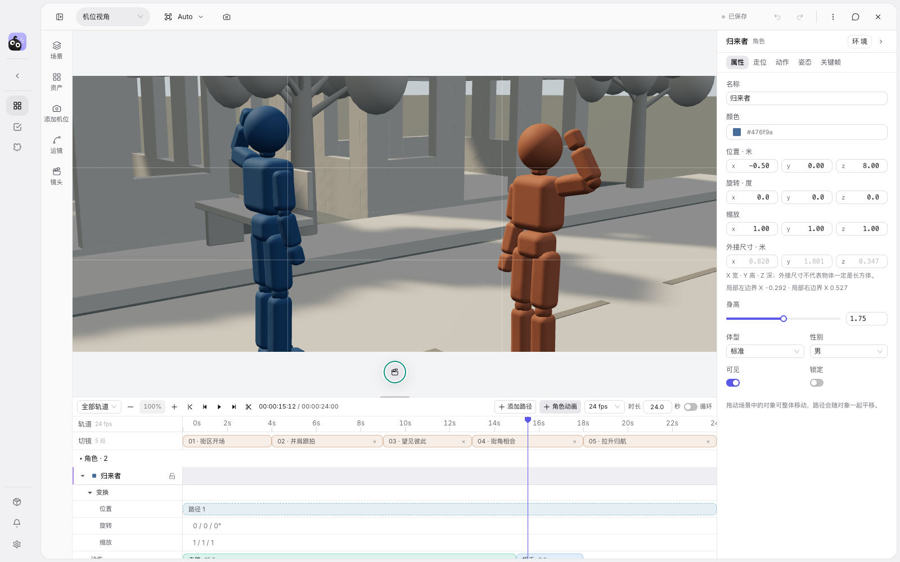
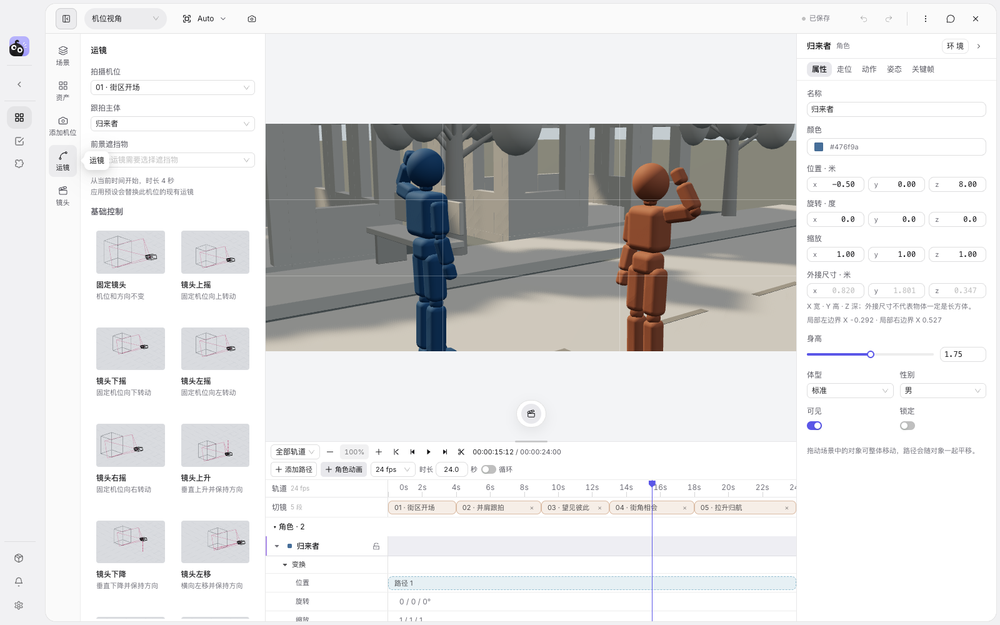
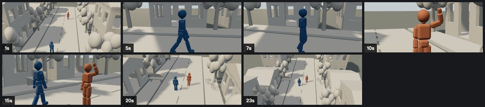

<p align="center"></p>
<h1 align="center">Shotloom</h1>
<p align="center">A desktop workspace for ideas, 3D previsualization, generated media and editing.</p>
<p align="center"><a href="./README.md">简体中文</a> · English · <a href="https://github.com/AstralFoundry/shotloom/releases">Downloads</a></p>



Shotloom organizes prompts, references, images, video and audio on an infinite canvas. Block a scene in the 3D director desk, plan actor movement and cameras, then continue with generation nodes and the embedded editor. Connections preserve the context and dependencies behind each iteration.

## Features

| Workspace | Capabilities |
| :-- | :-- |
| Creative canvas | Text, image, video, audio and tool nodes; reference connections, sections, selection, undo and automatic layout |
| 3D director desk | Characters, props, lighting, actions and motion paths; multiple cameras, cuts, focal keyframes, camera movement presets, timeline and live preview |
| Agent assistant | Project tools to inspect context, create and edit nodes, stage scenes, plan movement, check spatial relationships and render evidence; the full assistant requires the desktop Harness runtime |
| Media generation | Bring your own providers and models for text, image, video and audio; results return to the project |
| Video editor | Embedded OpenReel with multitrack editing, subtitles, graphics, transitions, image and volume adjustments, and export |
| Projects and assets | Local projects, reference definitions, media and project packages; Chinese and English interfaces |

## From idea to delivery

These current screenshots show the local web app with character references and the Homebound previs from this repository. The generation node shows inputs and configuration; no paid generation was started. The skill library shows real skills and Agent assignments. Full Agent conversations require the desktop runtime. Screenshots use the Chinese interface; the application also supports English.

### Canvas and media generation

Keep briefs, character references, image nodes and video nodes on one infinite canvas. Connect nodes to pass references, then edit prompts, choose models and configure aspect ratios and inputs in place. Text, image, video and audio nodes can form a connected production workflow.



### Asset library

Collect character and scene references in the project library, find them by name or category and reuse them on the canvas. Shared assets support reuse across projects. Reference definitions remain linked to their source media.



### Agents and skills

Canvas, text, director and editing Agents use real product tools in their respective workspaces. The skill library shows descriptions, versions, enabled states and Agent assignments. Import, export or create skills for scripts, storyboards, character references, ecommerce and social content. Project tasks provide a view of generation jobs and execution status.



### Video editor

Embedded OpenReel brings media into a multitrack timeline with a player for reviewing timing. Add text, subtitles, graphics, effects and transitions; adjust images and audio, then create a video node. This screenshot shows the existing Homebound video loaded into an actual editing timeline.



### 3D director desk

Check framing, actor movement and camera motion in space before continuing production. Stage scenes, animate characters and use camera movement presets, multicamera cuts and timeline preview.



<details>
<summary>View camera movement presets</summary>



</details>

## Real demo: Homebound

[Watch the 24-second previsualization](./docs/demos/homebound/homebound-final.mp4) · [Director scene](./docs/demos/homebound/homebound.scene.json) · [Production notes and tool limitations](./docs/demos/homebound/README.md)

Two characters, a neighborhood street and five cameras: an establishing crane shot, lateral tracking, a greeting close-up, a two-shot and a rising departure. Scene construction, animation, paths, cameras and cuts were created through the existing Agent tool execution entry point. The contact sheet contains actual rendered frames.



This is a silent 3D previs, not a generative finished film. The exercise called the real product tool dispatcher in a browser test session; it did not run a desktop model conversation. Video encoding succeeded, but saving the output as a canvas asset node failed in the browser. See the production notes for evidence and limitations.

Director tools now support named batch references, shot composition, timed actions, retained export recovery, delivery packages and audio/subtitle editing handoff. See [capabilities and verification scope](./docs/director-agent-capabilities.md).

## Getting started

Download macOS Apple Silicon or Windows x64 builds from [Releases](https://github.com/AstralFoundry/shotloom/releases). Add your provider credentials and model configuration in **Settings → API providers** before using generation. The canvas and director desk can be used without a model connection.

For development, install Node.js ≥ 22.19.0, npm ≥ 10, Rust stable and the [Tauri 2 system dependencies](https://v2.tauri.app/start/prerequisites/).

```bash
git clone https://github.com/AstralFoundry/shotloom.git
cd shotloom
npm ci
npm run dev
```

To inspect the web interface only:

```bash
npm run dev:web
```

The browser does not offer the complete desktop experience. Agent Host, native file saving, some media exports and editor integration require the desktop runtime. `shotloom.yml` controls development services, window configuration and new-project defaults. Existing user settings take priority; restart after changing configuration.

## Development

| Command | Purpose |
| :-- | :-- |
| `npm run check` | Configuration, types, translations, storage, layers, styles, UI and regression tests |
| `npm run harness:test` | Harness host tests |
| `npm --prefix vendor/shotloom-director-desk test` | Director browser, timeline and depth tests |
| `corepack pnpm -C vendor/openreel test:run` | OpenReel workspace tests |
| `npm run prepare:director-desk` | Build the iframe director desk |
| `npm run prepare:openreel` | Build the embedded editor |
| `npm run build:desktop` | Build the desktop application |

React, TypeScript and Vite power the frontend; Tauri / Rust provide the desktop shell. React Flow powers the canvas and Three.js / React Three Fiber power 3D. The director lives in `vendor/shotloom-director-desk/`, isolated through iframe / postMessage. OpenReel lives in `vendor/openreel/` and is embedded through ShadowRoot. The Harness client does not own product domain state.

Read [AGENTS.md](./AGENTS.md) and the [engineering guide](./docs/engineering.md) before contributing. The model owns intent and production decisions; code enforces permissions and data integrity. Keep domain and UI state separate. Branch from `develop`, run the checks and open a PR against `develop`.

## Licensing

The repository root does not currently declare a LICENSE; all rights are reserved by default. Third-party code retains the licenses in its respective directories. Check those terms before use or distribution.
