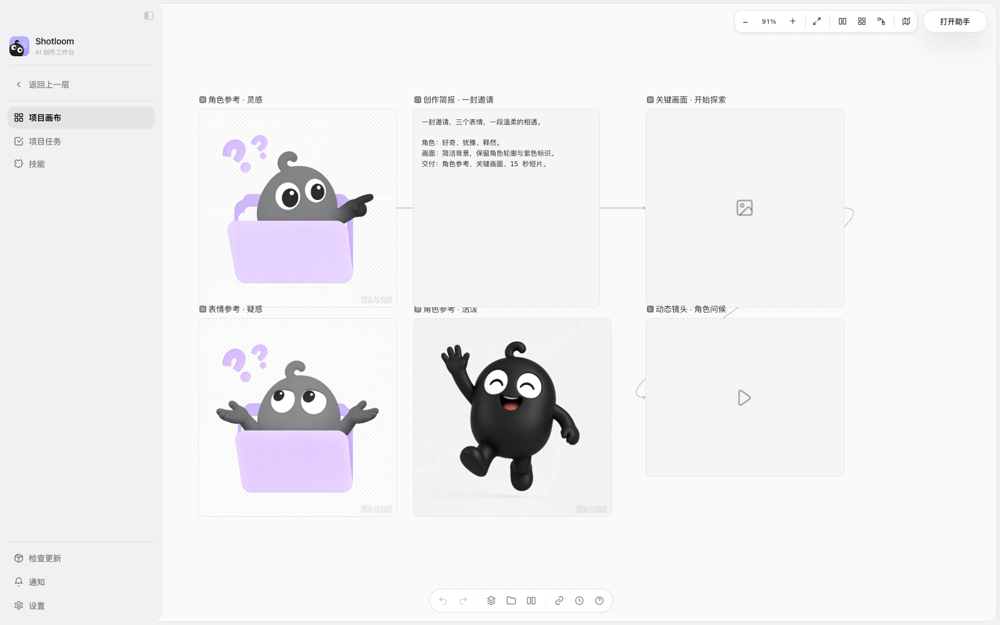
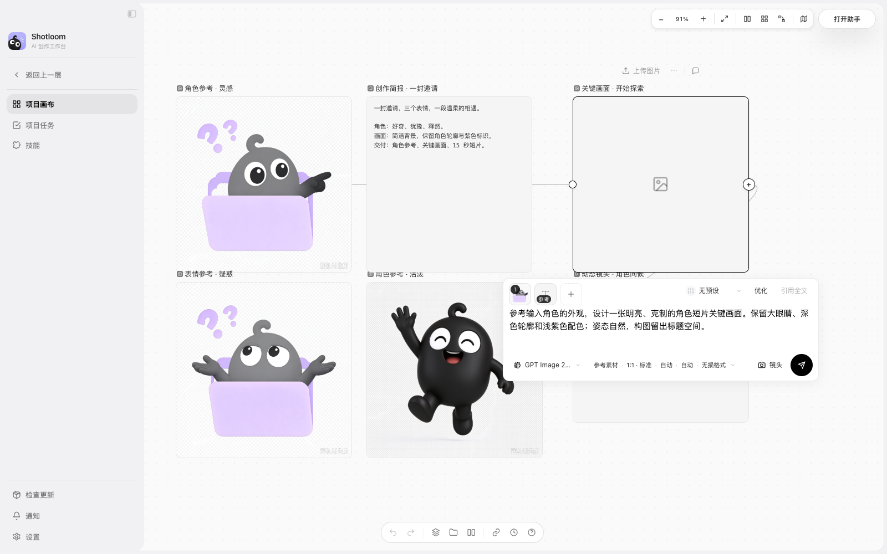
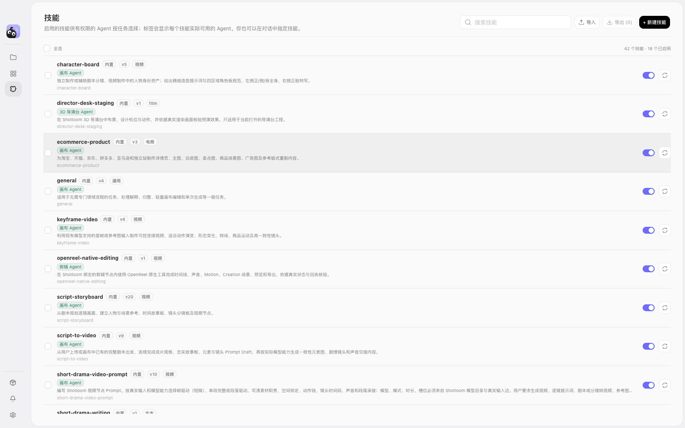
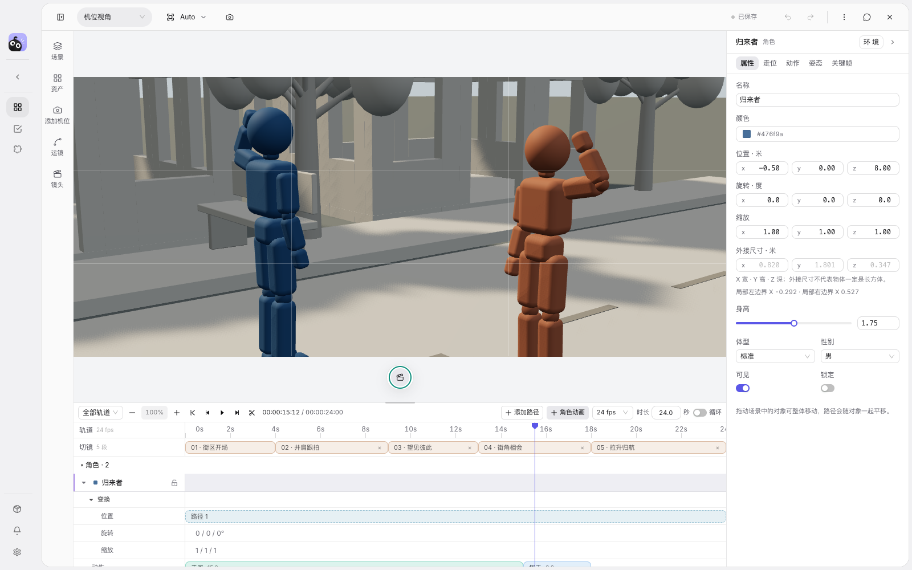
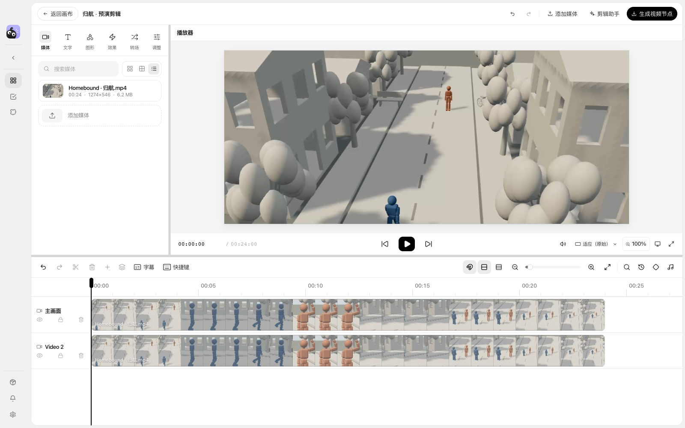
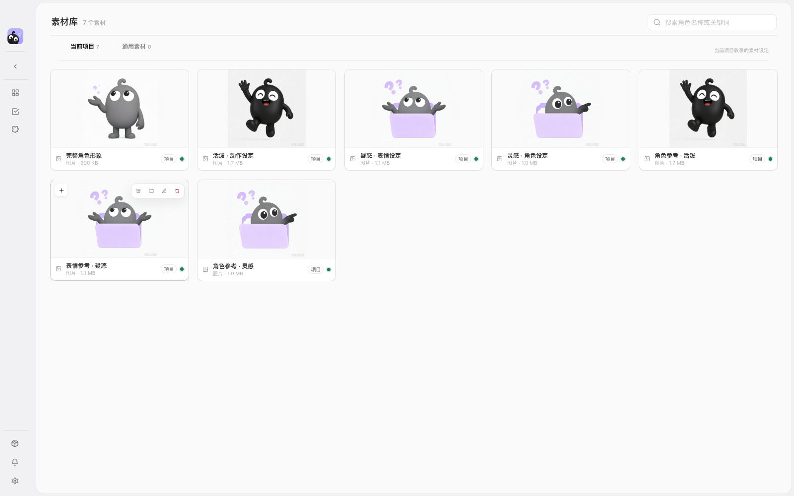

<p align="center"></p>
<h1 align="center">Shotloom</h1>
<p align="center">From ideas to moving images, on one canvas.</p>
<p align="center"><a href="./README.md">简体中文</a> · English · <a href="https://github.com/AstralFoundry/shotloom/releases">Download</a> · <a href="https://github.com/AstralFoundry/shotloom/issues">Feedback</a></p>



Shotloom is a desktop workspace for AI filmmaking, bringing an infinite canvas, AI generation, 3D previsualization and video editing into one project. Connect references and ideas, then work with Agents on scripts, storyboards and production.

## Keep the whole production in one project

Making a video often means switching between chats, reference folders, generation platforms and editing software. Shotloom brings the work onto a shared canvas: briefs, character references, source media and generated results sit side by side, with connections that preserve their relationships as you iterate.

Start with a piece of writing, import existing media, or explore a composition in 3D before moving on to generation and editing.

## Features

### Infinite canvas and media generation

Arrange text, images, video and audio on one canvas. Use sections to organize scenes or production stages and connect nodes to pass reference inputs. Select a generation node to edit its prompt, choose a model and adjust parameters.

- Place images, video and audio as media nodes or use them as inputs for further generation.
- Keep text, image, video and audio generation in the context of the project, with results saved back to it.
- Organize a growing canvas with multiselection, automatic layout, undo and redo.



### Work with Agents

Agents can use project context to help develop ideas and operate the workspace through tools. Draft briefs, scripts and storyboards; create canvas nodes; stage scenes; and edit media. Review and adjust the resulting work in the interface.

Canvas, text, director and editing Agents serve their respective workspaces. The skill library lets you enable, import, export and create reusable production methods. Project tasks provide a central view of generation progress and results.

<details>
<summary>View the skill library</summary>



</details>

### 3D director desk: explore your shots first

Build scenes in 3D, position characters, props and lights, and plan actor movement and camera motion. Use the timeline and live preview to check framing, spatial relationships and timing before taking the previs into further production.

Work with multiple cameras, focal-length keyframes, character actions, motion paths and camera movement presets. Adjust scenes manually or ask the director Agent to help stage and sequence shots.



[Watch the 24-second Homebound 3D previs](./docs/demos/homebound/homebound-final.mp4) · [Example scene](./docs/demos/homebound/homebound.scene.json)

### Video editor: assemble your footage

The built-in editor, based on OpenReel, provides a multitrack timeline and player. Add text, subtitles, graphics, transitions and effects, adjust the picture and audio, then export a video.

Editing and the canvas belong to the same project, making it easier to iterate between generating media, replacing shots and adjusting the timeline.



### Projects and assets

Collect character, scene and other reference definitions in the asset library. Find them by name or category and reuse them on the canvas. Shared assets support reuse across projects, while project assets stay with the current work.

Autosave, version history and project package import/export help you revisit earlier canvas states or move a project. Chinese and English interfaces are available.

<details>
<summary>View the asset library</summary>



</details>

## Plugins and models

Shotloom connects to AI services through provider plugins. A single plugin can supply both generation models and canvas tools using the same connection and API key. Install plugins from npm, a local file or a URL, and enable, disable or uninstall them in Plugin center.

- **Generation models** appear in the relevant node's model list for text, image, video and audio generation.
- **Canvas tools** offer actions for selected media, such as upscaling an existing video. Available capabilities depend on the installed plugin.
- **Bring your own API key**: Configure the service credentials and endpoint in the plugin settings, then enable the models you need.

Developers can add providers or media workflows through plugins that define models, parameters and canvas actions. See [Using plugins](./docs/provider-plugins.md) and [Plugin development](./docs/plugin-development.md).

## A typical workflow

1. **Collect ideas**: Create a project and bring briefs, scripts and references onto the canvas.
2. **Plan the visuals**: Develop character and scene references, using the director desk to explore composition and camera motion when useful.
3. **Produce media**: Generate images, video or sound with your chosen models, then compare and iterate on the canvas.
4. **Edit and deliver**: Assemble media on the timeline, adjust pacing, subtitles and sound, then export the video.

Work manually at any stage, or use the relevant Agents and skills to help.

## Getting started

Download a macOS Apple Silicon or Windows x64 installer from [Releases](https://github.com/AstralFoundry/shotloom/releases).

1. Create a project, import reference media or add canvas nodes.
2. Enable a provider plugin in **Plugin center**, then open its settings to enter your API key and select available models.
3. Choose a model and configure inputs in a generation node, or open an Agent to start working.

You can organize media on the canvas and build scenes in the director desk without connecting a generation model. Model access, usage limits and charges are determined by the service provider.

## Run from source

Requires Node.js ≥ 22.19.0 and npm ≥ 10.

```bash
git clone https://github.com/AstralFoundry/shotloom.git
cd shotloom
npm ci
npm ci --prefix harness/host
npm ci --ignore-scripts --prefix vendor/shotloom-director-desk
npm run dev
```

The first launch prepares the required resources and may take some time. Use `npm run dev:web` to preview the web interface; use the desktop app for the full experience.

Common development commands:

| Command | Purpose |
| --- | --- |
| `npm run dev` | Start desktop development |
| `npm run dev:web` | Start the web preview |
| `npm run check` | Run static checks and product tests |
| `npm run verify:product` | Run full product verification and build |
| `npm run build:desktop` | Build desktop installers |

## Documentation and contributions

- [Using plugins](./docs/provider-plugins.md)
- [Plugin development](./docs/plugin-development.md)
- [Engineering guide](./docs/engineering.md)
- [Issues and suggestions](https://github.com/AstralFoundry/shotloom/issues)

Bug reports, documentation improvements and code contributions are welcome. For code changes, branch from `develop`, run `npm run verify:product` and open a PR against `develop`. When reporting a problem, include your OS, app version, reproduction steps and relevant screenshots or logs.

## Acknowledgements

Thanks to [all contributors](https://github.com/AstralFoundry/shotloom/graphs/contributors), and to [MA HE (@piomeer)](https://github.com/piomeer) for improving Windows compatibility.

Shotloom's canvas, 3D and editing capabilities also benefit from projects including [React Flow](https://github.com/xyflow/xyflow), [Three.js](https://github.com/mrdoob/three.js) and the integrated OpenReel source.

## License

Shotloom's original code is available under the [MIT License](./LICENSE), allowing use, modification, commercial use and distribution with the copyright and permission notice retained. Third-party code and assets retain their own licenses; see [Third-party notices](./THIRD_PARTY_NOTICES.md).
