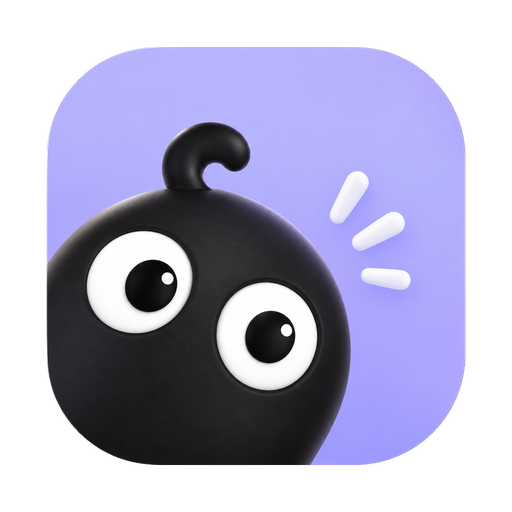
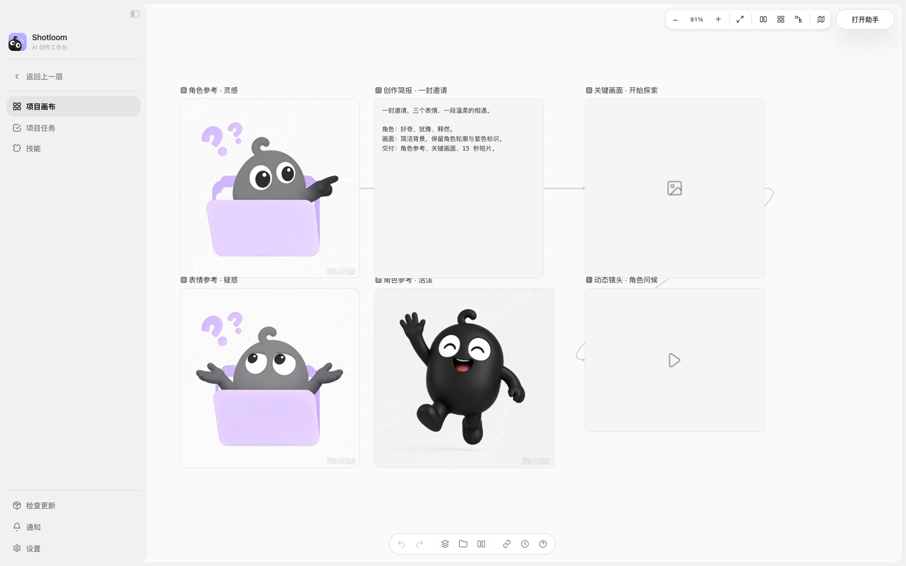
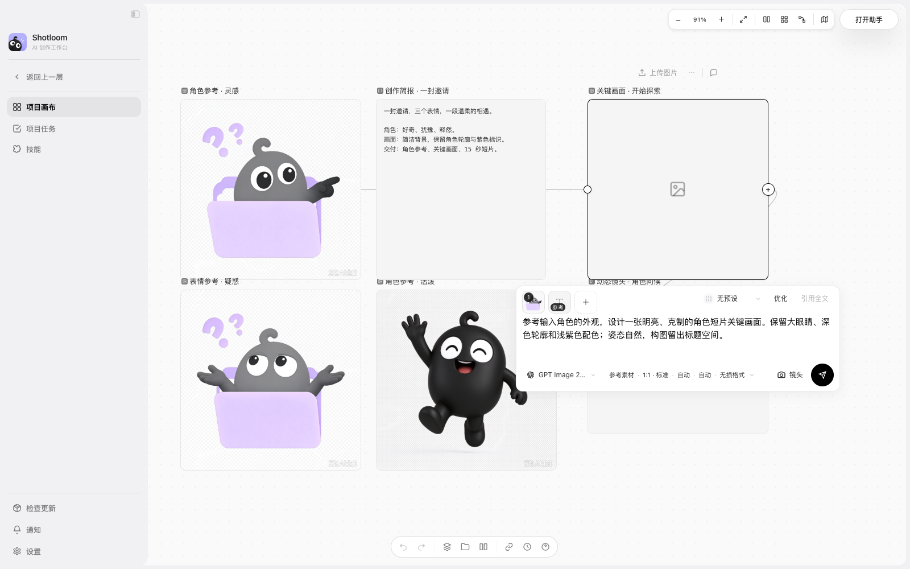
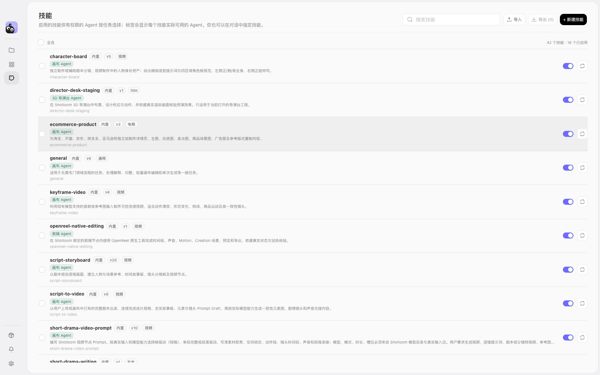
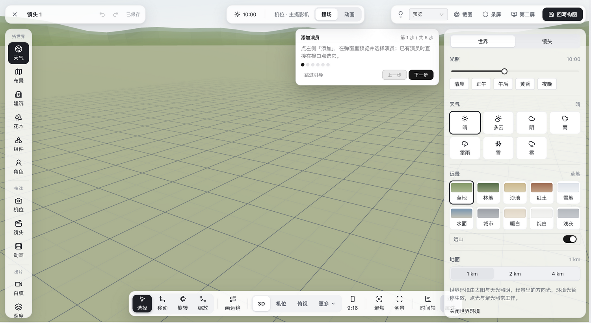
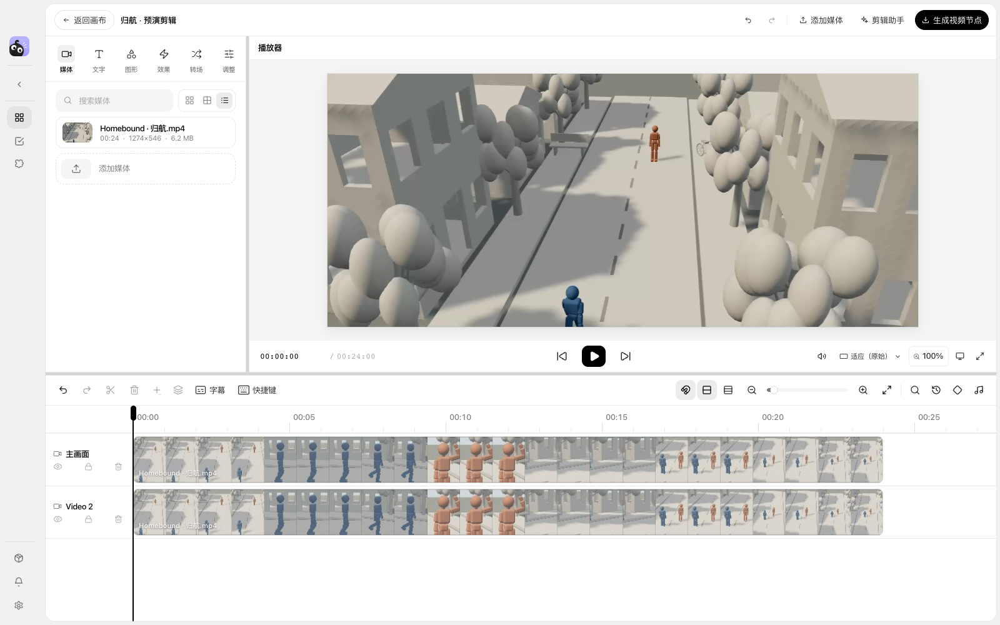
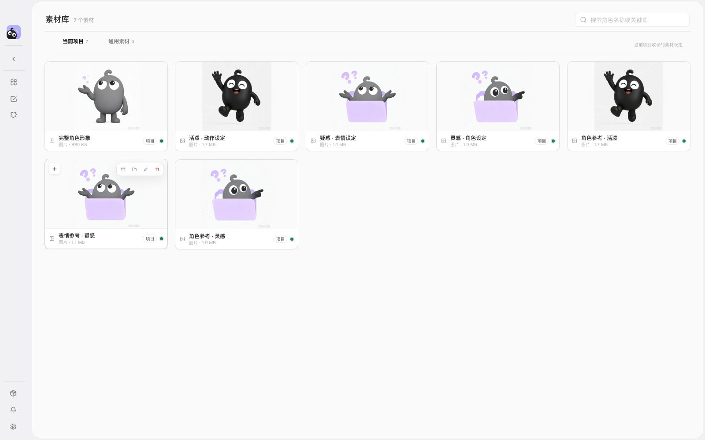

<p align="center"></p>
<h1 align="center">织帧画布 Shotloom</h1>
<p align="center">在一张画布上，完成从创意到影像的创作。</p>
<p align="center">简体中文 · <a href="./README.en.md">English</a> · <a href="https://github.com/AstralFoundry/shotloom/releases">下载</a> · <a href="https://github.com/AstralFoundry/shotloom/issues">反馈</a></p>



Shotloom 是面向 AI 影像创作的桌面工作台，将无限画布、AI 生成、3D 预演和视频剪辑放在同一个项目中。把参考素材和创作思路连起来，与 Agent 一起推进剧本、分镜和制作。

## 为影像创作组织整个项目

一段视频的制作往往散落在聊天窗口、参考图文件夹、生成平台和剪辑软件里。Shotloom 用画布把这些内容放在一起：创作简报、角色设定、参考素材和生成结果可以并排查看，通过连线保留彼此的关系，便于修改和继续制作。

你可以从一段文字开始，也可以先导入已有素材，或在世界引擎中尝试构图，再逐步推进到生成与剪辑。

## 主要功能

### 无限画布与多模态生成

把文本、图片、视频和音频组织在同一张画布上。用分区整理不同场景或制作阶段，用连线传递参考输入；选中生成节点即可编辑提示词、切换模型和调整参数。

- 图片、视频和音频可作为素材放入画布，也可作为后续生成的参考。
- 文本、图片、视频和音频生成共用项目上下文，结果保存回项目。
- 多选、自动布局、撤销与重做帮助整理不断扩展的创作内容。



### 与 Agent 一起制作

Agent 可以结合项目内容协助创作，并通过工具操作工作区。从整理简报、编写剧本和分镜，到创建画布节点、布置场景与剪辑素材，工作结果可以继续在界面中查看和调整。

画布、文本和剪辑 Agent 分别面向对应工作区；世界引擎由画布节点和侧栏工作区进入。技能库用于保存和复用制作方法，支持启用、导入、导出和创建技能；项目任务页集中展示生成任务的进度与结果。

<details>
<summary>查看技能库</summary>



</details>

### 世界引擎：先看镜头，再继续制作

在真实天空、太阳和天气下搭建镜头场景：选择地表与远景，摆角色、道具和灯光，用多机位和时间轴检查构图、空间关系与动作节奏。白膜、深度、法线和骨骼视图可直接与生成模型对位，构图、白膜、深度视频可以回写成画布节点。

引擎取自 [open-ai-canvas](https://github.com/ddcat-ai/open-ai-canvas) 的性能预演工作台，独立编译后以 iframe 运行；镜头场景是一份纯 JSON，随工程保存。



### 剪辑台：把素材组织成片

内置基于 OpenReel 的视频剪辑台。将素材放入多轨时间线，通过播放器检查节奏，添加文字、字幕、图形、转场与效果，调整画面和音频后导出视频。

剪辑与画布放在同一个项目中，适合在素材生成、镜头替换和时间线调整之间反复迭代。



### 项目与素材管理

将角色、场景和其他参考设定整理进素材库，按名称和分类查找，再引用到画布。通用素材库用于跨项目复用，项目素材与当前创作内容一起管理。

项目支持自动保存、版本记录和项目包导入导出，方便回看之前的画布状态或转移工程。界面支持简体中文与英文。

<details>
<summary>查看素材库</summary>



</details>

## 插件与模型

Shotloom 通过厂商插件接入 AI 服务。一个插件可以同时提供生成模型和画布工具，共用连接与 API Key。插件支持通过 npm、本地文件或 URL 安装，也可以在插件中心启用、停用或卸载。

- **生成模型**出现在对应节点的模型列表中，用于文本、图片、视频和音频生成。
- **画布工具**根据选中的素材提供处理入口，例如对已有视频进行超分；实际能力由安装的插件决定。
- **自带 API Key**：在插件设置中填写对应服务的凭据和接口地址，按需启用模型。

开发者可以为新的厂商或媒体处理工作流编写插件，接入模型、参数和画布入口。详见 [插件使用说明](./docs/provider-plugins.md) 与 [插件开发指南](./docs/plugin-development.md)。

## 一个常见的创作流程

1. **整理想法**：创建项目，将简报、剧本和参考素材放入画布。
2. **确定画面**：整理角色与场景设定，必要时用世界引擎预演构图和运镜。
3. **制作素材**：选择模型生成图片、视频或声音，在画布上比较和迭代。
4. **剪辑交付**：将素材组织到时间线，调整节奏、字幕与声音，导出视频。

每个阶段都可以手动操作，也可以借助对应的 Agent 与技能推进。

## 开始使用

从 [Releases](https://github.com/AstralFoundry/shotloom/releases) 下载 macOS Apple Silicon 或 Windows x64 安装包。

1. 创建项目，导入参考素材或新建画布节点。
2. 在 **插件中心** 启用需要的厂商插件，打开设置填写 API Key 并选择可用模型。
3. 在生成节点中选择模型并设置输入，或打开 Agent 开始创作。

无需接入生成模型，也可以使用画布整理素材和在世界引擎中搭建场景。AI 服务的模型权限、用量与费用由对应服务商决定。

## 源码运行

需要 Node.js ≥ 22.19.0、npm ≥ 10。

```bash
git clone https://github.com/AstralFoundry/shotloom.git
cd shotloom
npm ci
npm ci --prefix harness/host
npm ci --ignore-scripts --prefix vendor/open-ai-canvas-previs
npm run dev
```

首次启动会准备所需资源，耗时较长。只预览网页界面可运行 `npm run dev:web`；完整功能请使用桌面版。

常用开发命令：

| 命令 | 用途 |
| --- | --- |
| `npm run dev` | 启动桌面开发环境 |
| `npm run dev:web` | 启动网页预览 |
| `npm run check` | 执行静态检查和产品测试 |
| `npm run verify:product` | 执行完整产品验证与构建 |
| `npm run build:desktop` | 构建桌面安装包 |

## 文档与贡献

- [插件使用说明](./docs/provider-plugins.md)
- [插件开发指南](./docs/plugin-development.md)
- [工程约定](./docs/engineering.md)
- [提交问题与建议](https://github.com/AstralFoundry/shotloom/issues)

欢迎反馈问题、改进文档或提交代码。代码贡献请从 `develop` 创建分支，运行 `npm run verify:product` 后向 `develop` 提交 PR。反馈问题时，请附上系统、应用版本、复现步骤及相关截图或日志。

## 致谢

感谢 [所有贡献者](https://github.com/AstralFoundry/shotloom/graphs/contributors)，以及 [MA HE (@piomeer)](https://github.com/piomeer) 对 Windows 兼容性的改进。

Shotloom 的画布、三维与剪辑能力也受益于 [React Flow](https://github.com/xyflow/xyflow)、[Three.js](https://github.com/mrdoob/three.js) 和仓库中集成的 OpenReel 等项目。

## 许可证

Shotloom 原创代码采用 [MIT License](./LICENSE)，允许使用、修改、商用与分发，须保留版权和许可声明。第三方代码与素材遵循各自许可证，详见 [第三方声明](./THIRD_PARTY_NOTICES.md)。
