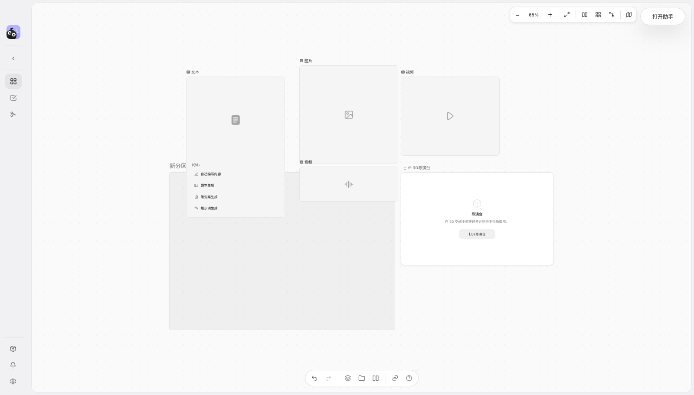
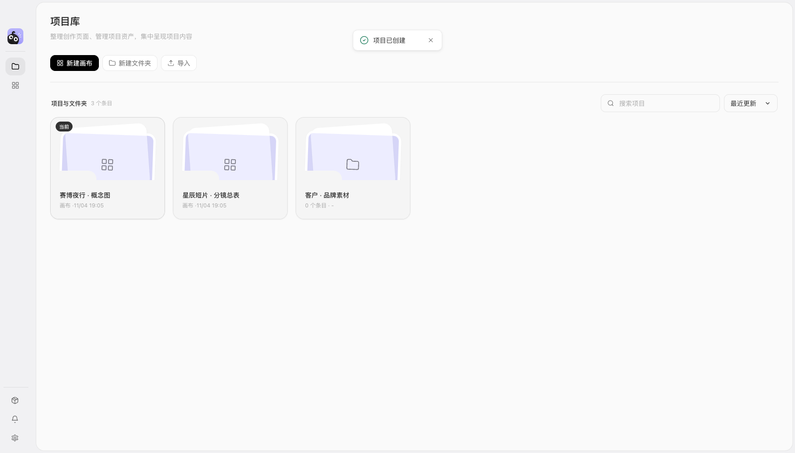
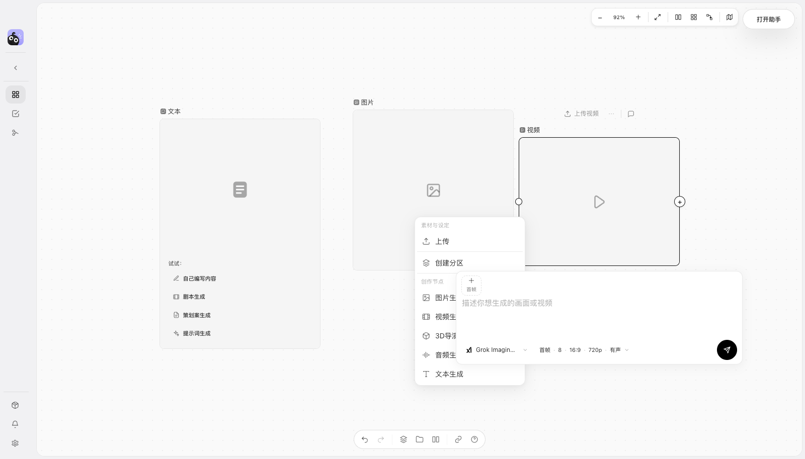
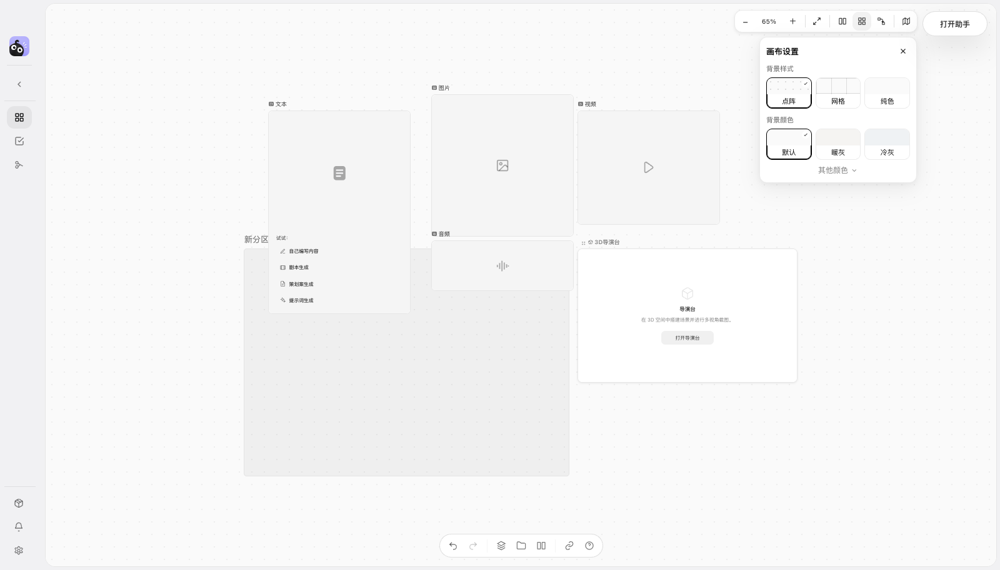
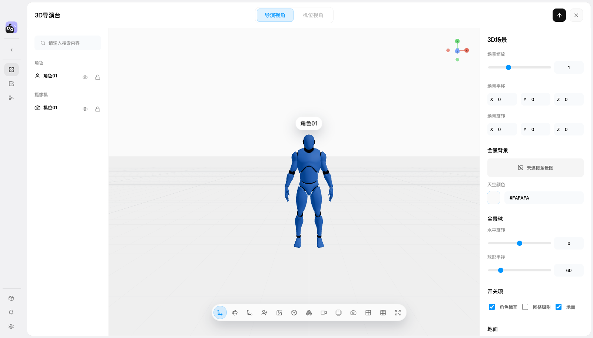

<p align="center">
  
</p>

<h1 align="center">织帧画布 Shotloom</h1>

<p align="center">
  <strong>别让 AI 作品停留在聊天记录里。</strong><br>
  面向 AI 影像创作者的桌面工作台——把散落的提示词、参考图、生成结果和创作意图，<br>
  编织成一部真正可交付的作品。
</p>

<p align="center">
  <a href="https://github.com/AstralFoundry/shotloom/releases/latest"></a>
  
  <a href="https://github.com/AstralFoundry/shotloom/actions/workflows/ci.yml"></a>
  <a href="#-参与贡献"></a>
</p>

<p align="center">
  <a href="#-能力一览">能力</a> ·
  <a href="#-界面预览">界面</a> ·
  <a href="#-快速开始">快速开始</a> ·
  <a href="#-开发">开发</a> ·
  <a href="#-参与贡献">贡献</a>
</p>



## 🤔 为什么是织帧画布

用 AI 做影像创作，最难的从来不是「生成一张好图」，而是**第三张之后**——几十个版本在聊天窗口里来回滚动，参考图和结果散落在下载目录各处，你已经分不清哪个版本基于哪条提示词、用了哪张参考图，该进剪辑还是进废纸篓。

于是你打开剪辑软件，把勉强选出的几段拖进去，发现风格不统一、构图接不上——回到聊天窗口，再生成几版。循环往复。

**织帧画布把这个循环变成一条直线。**

| 你现在的困境 | 织帧画布的做法 |
| :-- | :-- |
| 提示词散落在聊天记录里 | 每个节点记录完整的提示词、参数与来源 |
| 素材堆满下载文件夹 | 素材自动归属项目，始终可预览、可溯源 |
| 说不清 A 图和 B 图的关系 | 连线表达参考、迭代与依赖，整条链路一眼看清 |
| 生成归生成，剪辑归剪辑 | 从灵感到导出，在同一个工具里走完 |
| AI 助手对项目一无所知 | 助手直接读取画布上下文，给针对性建议 |

它不是又一个 AI 生图工具，而是 AI 影像创作缺失的那一层。

## ✨ 能力一览

<table>
  <tr>
    <td width="50%" valign="top">
      <h3>🎨 可视化创作画布</h3>
      文本、图片、视频、音频节点自由排布，连线表达上下文与依赖。支持缩放、框选、多选、拖拽、撤销、自动布局，以及<strong>分区</strong>与<strong>显示设置</strong>——把复杂项目按段落切开，按你的习惯呈现。
    </td>
    <td width="50%" valign="top">
      <h3>🤖 Agent 创作助手</h3>
      基于官方 <strong>Harness</strong> Agent 运行时，读取当前项目与画布上下文，知道你在做什么、做到哪一步。它会创建节点、分析瓶颈、配合 Skill 推进这一步——你看到的不是一段回复，而是画布上多出来的那几张图。
    </td>
  </tr>
  <tr>
    <td valign="top">
      <h3>🌀 多模态生成</h3>
      文字构思 → 静态画面 → 动态镜头 → 声音。文本、图片、视频、音频模型在同一工作区衔接，参考输入直接来自画布节点，生成结果自动回到项目。
    </td>
    <td valign="top">
      <h3>📦 项目与素材管理</h3>
      素材设定（人物外貌、场景风格）与真实素材文件分开管理，支持项目内素材与本机通用素材。导入一个项目包，它就真的是一个完整项目。
    </td>
  </tr>
  <tr>
    <td valign="top">
      <h3>🎬 3D 导演台</h3>
      生成之前先想清楚机位、空间与角色关系。在三维场景中摆放角色、道具和摄影机，用上游图片做场景参考，导出构图结果继续用于后续节点。
    </td>
    <td valign="top">
      <h3>✂️ 剪辑节点</h3>
      剪辑能力以<strong>独立节点</strong>形态长在画布上：多轨时间线、字幕、贴图、转场、画面变换、音量控制，选中即在节点上方浮出 16:9 预览，也可展开为全屏剪辑台并直接导出。
    </td>
  </tr>
</table>

画布上的一切都是一个节点，连线即上下文：

| 类别 | 节点 | 作用 |
| :-- | :-- | :-- |
| 生成 | `textGeneration` | 剧本、策划案、提示词 |
| 生成 | `imageGeneration` | 静态画面，支持参考图与裁剪标注 |
| 生成 | `videoGeneration` | 动态镜头 |
| 生成 | `audioGeneration` | 配音与声音 |
| 工具 | `clipStudio` | 内嵌剪辑台，时间线即节点 |
| 工具 | `threeDDirector` | 3D 导演台，机位与空间预演 |
| 资源 | `resource` | 拖入的本地素材，可预览可溯源 |
| 组织 | `canvasSection` | 分区，把节点按段落归组 |

## 📸 界面预览

<table>
  <tr>
    <td width="50%"><p align="center"><b>项目库</b> · 创建、整理和打开本地项目</p></td>
    <td width="50%"><p align="center"><b>节点与生成配置</b> · 右键画布创建节点，选择模型与参数</p></td>
  </tr>
  <tr>
    <td><p align="center"><b>画布显示设置</b> · 背景样式与背景颜色</p></td>
    <td><p align="center"><b>3D 导演台</b> · 预演摄影机、角色与空间关系</p></td>
  </tr>
</table>

剪辑台与 Agent 助手依赖桌面运行时，暂未纳入以上截图。

## 🚀 快速开始

**下载**：到 [Releases](https://github.com/AstralFoundry/shotloom/releases/latest) 获取安装包，macOS 为 `.dmg`（Apple Silicon），Windows 为 `.exe`（x64）。

**源码运行**需要 Node.js ≥ 22.19.0、npm ≥ 10、Rust stable，以及对应平台的 [Tauri 2 系统依赖](https://v2.tauri.app/start/prerequisites/)：

```bash
git clone https://github.com/AstralFoundry/shotloom.git
cd shotloom
npm ci && npm run dev
```

首次启动会编译 Rust 依赖，稍等一会儿，后续启动就很快。只调前端：

```bash
npm run dev:web
```

浏览器模式不提供文件系统、原生导出、剪辑运行时与 Agent 助手，完整体验请用桌面版。开发服务允许最大 64 KiB 请求头以兼容本机共享 Cookie；若遇到 Vite 431 错误，重启开发进程，仍报错则清理对应站点不再使用的 Cookie（参见 [Vite 排查说明](https://vite.dev/guide/troubleshooting.html#_431-request-header-fields-too-large)）。

**接上模型**：不接模型也能建项目和整理素材。要用生成节点或助手时，打开 **设置 → API 厂商**，添加厂商与凭据、配置模型协议，再为文本、图片、视频、音频分别指定默认模型。各厂商接口有差异，以官方 API 文档为准。

## 📁 项目结构

```text
shotloom/
├─ renderer/            # React 前端（画布、剪辑、助手、设置）
│  ├─ src/app/          # 界面与画布组件
│  ├─ src/agent/        # Agent 契约、Prompt、工具
│  ├─ src/domain/       # 图数据与节点模型
│  ├─ src/store/        # 领域状态（domainReactivity）
│  └─ styles/           # 全局样式与色阶令牌
├─ src-tauri/           # Tauri 2 / Rust 桌面外壳与原生能力
├─ harness/             # 官方 Harness Agent 运行时宿主与内嵌客户端
├─ vendor/
│  ├─ openreel/                 # 剪辑引擎源码（内嵌运行时）
│  └─ storyai-3d-director-desk/ # 3D 导演台源码
├─ scripts/             # 构建、发布与工程约束校验
└─ tests/               # 回归测试
```

## 🛠 开发

| 命令 | 做什么 |
| :-- | :-- |
| `npm run dev` | 启动 Tauri 桌面开发环境 |
| `npm run dev:web` | 仅启动前端 dev server |
| `npm test` | 运行回归测试（100+ 文件，约 30s） |
| `npm run check` | 类型检查 + 测试 |
| `npm run check:layers` | 模块分层与状态引擎边界校验 |
| `npm run check:styles` | 样式分层与色阶令牌校验 |
| `npm run check:i18n` | 文案键与参数校验 |
| `npm run harness:test` | Harness 宿主测试 |
| `npm run build:desktop` | 构建桌面应用 |
| `npm run prepare:openreel` | 从 `vendor/openreel` 构建内嵌剪辑运行时 |

首次 `dev` / `build` 会自动执行 `prepare:openreel`：用 corepack 固定 pnpm 安装并构建 OpenReel，产物落在 `renderer/public/openreel`（已 gitignore），存在时按内容 hash 跳过。更新上游时替换 `vendor/openreel`，并保留 `apps/web/src/shotloom-*.ts|css` 这些宿主覆盖文件。

## 🧱 技术栈

| 层 | 选型 |
| :-- | :-- |
| 桌面框架 | Tauri 2 / Rust |
| 前端 | React 19 · TypeScript · Vite 7 |
| 画布 | `@xyflow/react`（React Flow v12） |
| 领域状态 | 自研 `domainReactivity`（就地可变 + revision 通知） |
| 界面状态 | Zustand（仅限 `app/` 与 `vendor/`） |
| Agent 运行时 | 官方 Harness（ShadowRoot 隔离 + 原生 IPC + Tool Bridge） |
| 3D 渲染 | React Three Fiber / Three.js |
| 剪辑引擎 | OpenReel（vendored，ShadowRoot 内嵌运行时） |
| 3D 导演台 | storyai-3d-director-desk（vendored，独立 HTML 入口 + iframe / postMessage 桥） |
| 文案 | 自研 i18n 字典（中 / 英） |

## 🏗 架构约定

改动前建议先读 [AGENTS.md](./AGENTS.md)，这里摘要三条最容易踩的边界：

- **模型负责判断，代码只守客观边界。** 意图理解、拆分粒度、制作质量交给 Agent；代码只强制权限、不可逆操作、数据真实性与完成声明。
- **两套状态引擎，不混用。** 领域与持久状态走 `domainReactivity`；界面状态走 Zustand 且只允许出现在 `app/` 与 `vendor/`，由 `npm run check:layers` 把关。
- **第三方源码只住 `vendor/`。** 导演台通过 iframe + postMessage 交互，剪辑运行时通过 ShadowRoot 内嵌，Harness 客户端同样不接管领域状态，三者都不导入产品 Store。

## 🤝 参与贡献

从 `develop` 切分支，完成后提 PR 回 `develop`；`main` 为发布分支。提交前本地跑一遍守门命令：

```bash
npm run check          # 类型检查 + 测试
npm run check:layers   # 分层与状态引擎边界
npm run check:styles   # 样式与色阶令牌
```

新增样式颜色请引用 `renderer/styles/tokens.css` 的具名色阶，不要写颜色字面量；涉及画布、Agent 工具或剪辑器的行为变更，请补一条对应的回归测试。

## 📄 许可证

仓库当前尚未声明 LICENSE 文件，默认保留所有权利。需要以特定许可证开源请先与维护者确认。

---

<p align="center">
  <sub>织帧画布 Shotloom · Weave every shot into a production-ready story.</sub>
</p>
