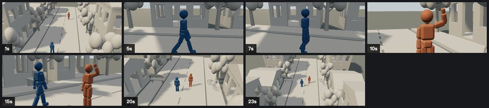

# 归航 · Homebound

[视频 / Video](./homebound-final.mp4) · [场景 / Scene](./homebound.scene.json) · [工具回执 / Tool receipts](./tool-receipts.json)

24 秒，24 fps，21:9，无声 H.264 预演。实际文件为 1274 × 546，6,506,470 字节。包含 2 位角色、20 件布景与道具、5 台摄影机、5 段切镜，以及走路、挥手和相机运动路径。

A silent 24-second, 24 fps, 21:9 H.264 previs. The actual export is 1274 × 546 and 6,506,470 bytes. The scene contains two actors, twenty props/set elements, five cameras, five cuts, walking and waving actions, and camera paths.

| 时间 / Time | 镜头 / Shot |
| :-- | :-- |
| 0–4s | 街区俯拍开场 / Establish the street |
| 4–9s | 归来者侧面跟拍 / Track the returning character |
| 9–13s | 迎接者挥手近景 / Greeting close-up |
| 13–18s | 双人街角相会 / Two-shot of the meeting |
| 18–24s | 拉升离场 / Rise and pull away |

## 执行与验证 / Execution and verification

使用本地 `5173` 网页版的真实 `executeProductRequest` 入口，绑定 canvas/director 会话，执行工具的 authorize 和 execute 阶段。测试会话在已有用户授权范围内传递 `approvedByHarness`；没有启动桌面 Harness 模型对话，也没有把场景直接写入 Store。空项目与测试绑定的初始化属于运行准备。

Scene production used the real web app's `executeProductRequest` entry point with canvas/director session bindings and authorization/execution phases. The test binding supplied `approvedByHarness` for the user-authorized work. No desktop Harness model conversation was run, and scene content was not written directly to the Store. Empty-project and test-session initialization were runtime setup.

实际调用 `director_desk_snapshot`、`director_desk_catalog`、`director_desk_batch`、`director_desk_command` 和 `director_desk_query`。用真实预览拼图发现并修正机位穿过建筑和树木的问题。最终 `spatial_check` 在 0–24 秒采样 96 次，0 条 error；17 条 warning 出现在 9.09–13.14 秒，主要是近景中另一人物出画，也覆盖切入双人镜头的开头。采样检查不代表逐帧保证。

The exercise used snapshots, asset catalogs, atomic batches, commands and queries. Rendered contact sheets exposed camera paths through buildings and trees; those paths were corrected. The final spatial check sampled 96 moments across 0–24 seconds: zero errors, with seventeen warnings between 9.09 and 13.14 seconds, mainly for the off-screen second character in the close-up, including the beginning of the following two-shot. Sampling is not a per-frame guarantee.

视频通过暴露的 `export_video_start` 编码。宿主收到 captures 消息后，测试脚本只把该消息携带的真实媒体字节留存到此目录，未使用其他渲染器制作替代视频。`ffprobe` 核验 H.264、24 fps 与 24.000 秒时长。

The exposed `export_video_start` command encoded the video. The test retained the real bytes from the host capture message; no alternate renderer produced the video. `ffprobe` verified H.264, 24 fps and a 24.000-second duration.

## 本次发现的能力缺口 / Observed tool gaps

1. **导出与入库耦合。** 编码完成且真实视频已发给宿主，但浏览器创建素材节点失败，任务最终只返回 `failed: 未能创建导出节点`。Agent 拿不到可用于恢复的 artifact ID 或下载引用。建议区分编码、文件保存、素材入库三个阶段，并允许重试入库而不重新编码。
   **Export and ingestion are coupled.** Encoding succeeded and media reached the host, but canvas-node creation failed in the browser. The final job only reports failure, without a recoverable artifact ID or download reference. Report each stage separately and support retrying ingestion.
2. **素材目录缺少参数范围。** 目录只列 `density` 等参数名，本次传入 0.8 后才得知合法范围为 4–48。部分建筑和道路的 `defaultSize` 也为空。建议返回范围、默认值、单位和 choices，减少试错。
   **Asset metadata is incomplete.** Parameter names omit ranges; `density:0.8` was rejected with the previously undisclosed 4–48 range. Some default dimensions are null. Return defaults, units, ranges and choices.
3. **新增实体不能在同一批中稳定引用。** 新 ID 在回执后才可用，因此新增相机、配置相机和写切镜需要分批。建议支持批内临时引用，并继续由运行时验证实体真实性。
   **New entities need a round trip before reuse.** Generated IDs arrive in receipts, so camera creation and dependent configuration/cuts need separate batches. Batch-local references would reduce round trips.
4. **动作默认时长与制作时长分离。** 添加 walk 默认只有 4 秒，需要再次查询 clipId 并延长到 15 秒。当前可以完成，但应在目录中暴露动作默认时长，并允许添加时指定起止时间。
   **Action timing requires extra calls.** Walk defaults to four seconds; the agent must read its clip ID and extend it. Expose durations in the catalog and accept timing at creation.
5. **空间警告缺少镜头意图。** 近景会报告另一角色出画；这些测量有价值，但无法单凭警告判断失败。可允许 Agent 显式指定每段镜头的检查主体，保留原始测量，不用代码猜意图。
   **Spatial checks lack shot subject scope.** An intentional close-up warns about the other actor being off-screen. Let the agent explicitly choose subjects per shot while preserving raw measurements.
6. **导出尺寸回执不充分。** 请求 size=1280，最终为 1274×546；任务没有说明实际宽高或取整策略。建议在开始与完成回执中返回实际尺寸、编码格式、帧数和文件引用。
   **Export dimensions are opaque.** A size=1280 request produced 1274×546. Report actual dimensions, codec, frame count and artifact reference.

以上是本次真实调用发现的问题，不代表未测试能力的结论。音乐、对白、精细表演、生成式成片及桌面入库恢复未在本次验证范围内。

These observations come from this exercise. Music, dialogue, detailed acting, generative finishing and desktop ingestion recovery were not validated.

## 后续实现 / Follow-up implementation

以上保留为当时制作记录。现在已补齐参数元数据与默认尺寸、命名批内引用、镜头原子编排、动作起止与循环、镜头主体检查、持久导出产物与重试、交付包及音频字幕剪辑交接。数字批内引用 `$1` 原本已存在，本次增加了命名引用。验证细节与剩余边界见 [能力说明](../../director-agent-capabilities.md)。本例视频仍是原始无声预演，没有据此追认桌面入库或有声成片已通过。

The observations above are the original production record. Follow-up work adds metadata, named references, atomic shot composition, timed/looping actions, subject-scoped checks, retained exports and recovery, delivery packages and audio/subtitle editing handoff. Numeric `$1` references already existed; named references are new. See the [capability guide](../../director-agent-capabilities.md) for tests and remaining boundaries. This demo remains the original silent previs.
