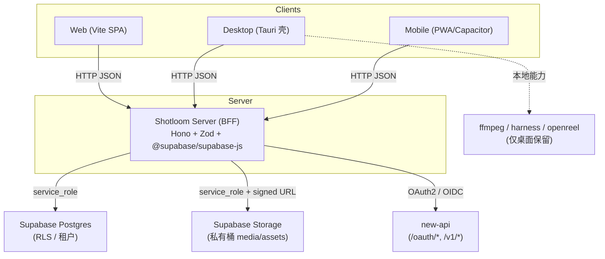
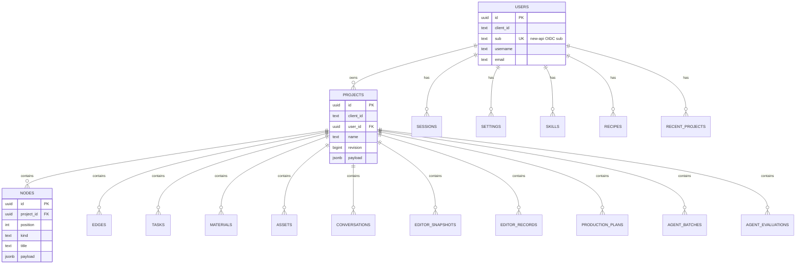

# Shotloom 云化迁移设计：Supabase 数据/对象存储 + new-api 登录服务端

> 目标：把 Shotloom（Tauri 桌面应用）的底层数据存储与对象存储迁移到 Supabase，
> 新增一个支持 new-api OIDC 登录的独立服务端（BFF），客户端统一支持 Web / 桌面 / 移动端。
>
> 本文档遵循文档驱动开发（DDD）：先固化架构、数据模型与迁移步骤，再进入编码。

## 1. 现状与结论

| 维度 | 现状 | 目标 |
|------|------|------|
| 数据存储 | Rust/SeaORM + SQLite（`app.sqlite`、`project.sqlite`、`assets.sqlite`、`clipboard.sqlite`） | Supabase Postgres（RLS + 租户字段） |
| 对象存储 | 本地文件系统（`app_data/local-asset-library/blobs`、`<project>/assets`），经 Tauri `asset://` 协议暴露 | Supabase Storage（私有桶 + 签名 URL） |
| 身份 | 无登录（本地单机） | new-api OIDC（OAuth2 Authorization Code + PKCE） |
| 客户端 | Tauri 桌面 + Web（localStorage 降级） | Web / 桌面（改造）/ 移动端 |
| 服务端 | 72 个 Tauri command（IPC） | 独立 BFF（HTTP REST） |

**关键事实**：前端所有数据访问都收敛在 `renderer/src/services/desktopApi.ts`（唯一读取
`window.__TAURI_INTERNALS__` 的位置），约 200+ 调用点经它分发。因此客户端改造的核心是
新增一个 HTTP 实现替换 Tauri 实现，上层无需改动。

## 2. 目标架构



### 分层职责

- **BFF**：唯一持有服务端密钥（service_role、会话加密密钥、OAuth client secret/verifier）。
  负责 new-api 登录、会话管理、领域数据 CRUD、对象上传/下载签名。所有 `/v1/*` AI 流量经其转发。
- **Supabase Postgres**：业务数据事实源，`client_id` + `user_id` 作为租户隔离点。
- **Supabase Storage**：媒体与素材对象，私有桶，DB 只存 `bucket` + `path`，读取走短时签名 URL。
- **客户端**：无任何密钥；通过会话 Cookie 与 BFF 交互。

### 保留在本地的桌面能力

ffmpeg 媒体处理、harness 运行时、openreel 导出、3D 导演台等重本地能力在 Web 端无等价实现，
仍由桌面端（Tauri 壳）通过本地插件提供，数据与身份统一走 BFF。

## 3. 数据模型（Rust 模型 → Postgres）

沿用 SeaORM 实体的语义，增加 `client_id` / `user_id` / `project_id` 租户维度；`file_path`
由绝对路径改为 Supabase Storage 的 `bucket` + `path`。



完整建表见 `supabase/migrations/`。要点：

- 所有业务表带 `client_id text not null` 与 `user_id uuid not null`（引用 `users.id`）。
- 项目级表带 `project_id uuid not null`（引用 `projects.id`，级联删除）。
- `materials.storage_path text`、`assets.storage_path text` 指向 Storage 对象；
  `materials.file_path` 语义由「磁盘绝对路径」收敛为「相对 key」。
- 全局目录（skills/recipes/settings/recent_projects）按 `user_id` 归属，不按 project。
- 索引对应原 `database/mod.rs::indexes`（kind、source、target、node_id、status、material_id 等）。

## 4. 身份与登录时序

```mermaid
sequenceDiagram
  participant C as 客户端
  participant B as BFF
  participant G as new-api
  participant S as Supabase

  C->>B: GET /api/auth/login
  B->>B: 生成 state/nonce/code_verifier，写 HttpOnly Cookie
  B-->>C: 302 → G /oauth/authorize (PKCE)
  C->>G: 用户在 new-api 授权
  G-->>C: 302 → B /api/auth/callback?code=...
  C->>B: GET /api/auth/callback?code
  B->>G: POST /oauth/token (code + verifier)
  G-->>B: access_token + refresh_token
  B->>G: GET /oauth/userinfo
  G-->>B: { sub, username, email }
  B->>S: upsert users(sub) → user_id
  B->>S: 写入 sessions（加密后的 token）
  B-->>C: Set-Cookie: shotloom_session=...; 302 → /
```

- 会话 Cookie：`HttpOnly` + `Secure`(生产) + `SameSite=Lax`，HMAC 签名。
- new-api token 以 AES-256-GCM 加密后存 `gateway_sessions`，仅 service_role 可读。
- 刷新：access token 过期前 60s 内 `POST /oauth/token (grant_type=refresh_token)` 轮换，
  `invalid_grant` 时清除会话并要求重新登录。
- 登录不创建 new-api 用户；以 `sub` 作为账户关联主键（`username`/`email` 可变，`email` 可为空）。

## 5. REST 接口契约

沿用 new-api `common/gin.go` 的 `{ success, message, data }` envelope 与统一分页/错误码：

- `POST /api/auth/login`、`GET /api/auth/callback`、`GET /api/auth/me`、`POST /api/auth/logout`
- `GET/PUT /api/project/:id`（保存/加载画布图数据，乐观锁 `revision`）
- `GET/PUT /api/settings`、`GET/PUT /api/catalog/:kind`（skills/recipes/assets/materials）
- `GET/POST/DELETE /api/recent`
- `GET/PUT /api/files`（Storage 上传/下载/签名 URL）
- `POST /api/relay/[...path]`（AI 转发，透传 `/v1/*`，不缓冲流）

## 6. 迁移步骤（roadmap）

1. ✅ 架构与数据模型设计（本文档）
2. Supabase 迁移：建表 + RLS + Storage 桶
3. BFF 骨架 + new-api OAuth 登录/会话
4. 领域 REST 接口（project/settings/catalog/recent/files）
5. 客户端：`desktopApi` 增加 HTTP 实现（Web 端数据路径）
6. 桌面端改造：Tauri 壳保留本地能力、数据/身份走 BFF
7. 移动端：PWA/Capacitor 复用 Web 客户端
8. 部署：BFF + Web 到 Vercel/容器，同步三处 origin（生产域名、OAuth redirect、Supabase redirect）

## 7. 安全清单（对齐 new-api-app-framework）

- [ ] `SUPABASE_SERVICE_ROLE_KEY`、`SESSION_ENCRYPTION_KEY` 仅服务端，永不 `NEXT_PUBLIC_*`。
- [ ] OAuth `state`/`nonce`/PKCE verifier 存 HttpOnly Cookie，回调时校验。
- [ ] 网关 token 只在内存/加密存储，不进日志、不进 `user_metadata`。
- [ ] RLS：业务表默认拒绝 anon/authenticated，仅 service_role 经 BFF 访问（BFF 为强制点）。
- [ ] 媒体对象仅存 `bucket` + `path`，读取走短时签名 URL。
- [ ] 余额/额度/订单/用量来自 new-api，本地无账本。
